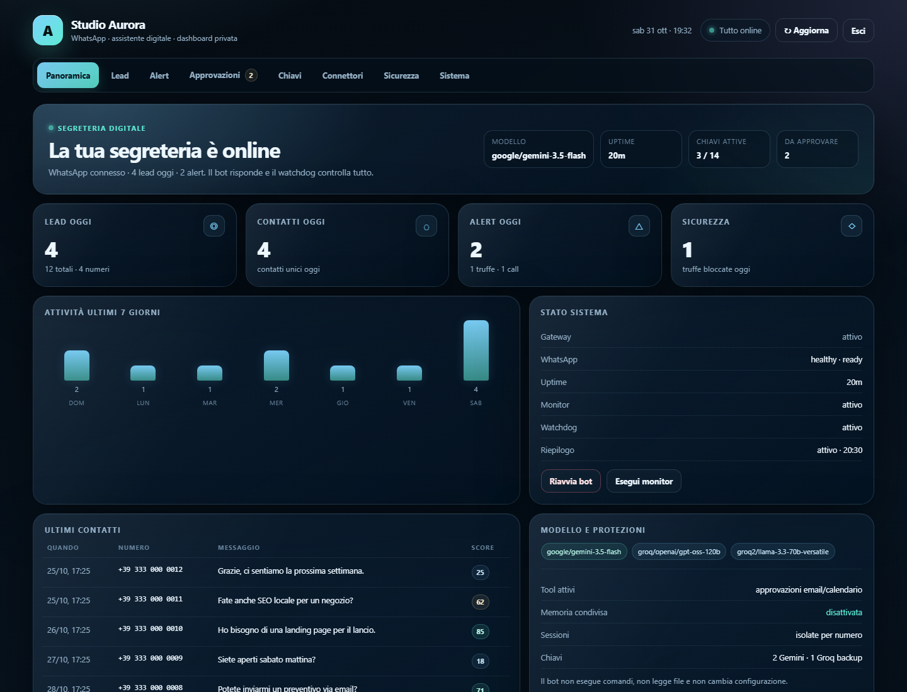
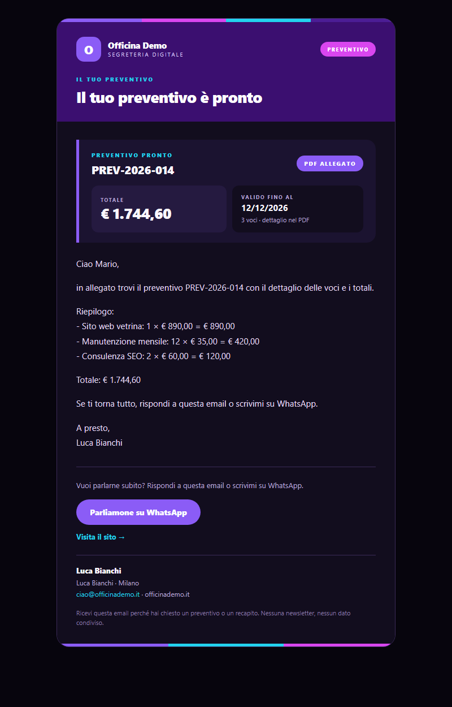
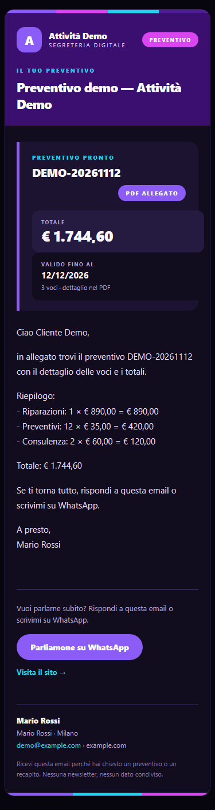

# Segreteria Digitale per WhatsApp

> **Repository ufficiale** della Segreteria Digitale self-hosted. È un progetto
> indipendente: non è un prodotto WhatsApp/Meta e non è affiliato a WhatsApp o Meta.

[](https://github.com/AhsenKurtoski/whatsapp-digital-secretary/actions/workflows/ci.yml)
[](https://github.com/AhsenKurtoski/whatsapp-digital-secretary/releases)
[](LICENSE)
[](https://github.com/AhsenKurtoski/whatsapp-digital-secretary/actions/workflows/ci.yml)

Una segreteria digitale **self-hosted** e privata per WhatsApp. Risponde ai clienti
con il tono della tua attività, conosce servizi e prezzi, raccoglie lead e richieste
di appuntamento, e prepara le azioni Gmail/Calendar che **approvi tu** dalla dashboard
locale.

Pensata per **aziende, studi professionali, artigiani e servizi locali** che ricevono
richieste su WhatsApp: risponde subito, prepara preventivi in PDF e non invia nulla
senza il tuo via libera. Sito pubblico: <https://gina-secretary.vercel.app>.

> [English](README.md) · **Italiano**



<details>
<summary>Email di preventivo — anteprima</summary>




</details>

## Stato del progetto

| | |
|---|---|
| **Ultima release** | [v1.1.1](https://github.com/AhsenKurtoski/whatsapp-digital-secretary/releases/tag/v1.1.1) — bridge Google affidabile, salute corretta con bridge attivo |
| **CI su `main`** | [Tutti i controlli verdi](https://github.com/AhsenKurtoski/whatsapp-digital-secretary/actions/workflows/ci.yml) (ultima verifica 20 nov 2026): test unitari, tutti i self-test Python, test di consegna email, handler del bridge Apps Script, sintassi degli script shell |
| **Python** | 3.11, 3.12, 3.13 e 3.14, tutte coperte dalla CI |
| **Piattaforme** | Linux o WSL2 con systemd utente (nessun Docker richiesto) |
| **Licenza** | MIT |

## Perché questo progetto

La maggior parte dei bot WhatsApp è generica oppure è un servizio SaaS costoso. Questo
progetto gira sul tuo computer, usa i tuoi dati reali, mantiene la memoria separata per
ogni cliente e non invia mai un'email né crea un evento in calendario senza la tua
approvazione esplicita.

È costruito sopra [OpenClaw](https://openclaw.ai) e sul client WhatsApp Web. È
software indipendente, non è un prodotto WhatsApp Business API e non è affiliato a
Meta o WhatsApp.

## Per chi è

- **Studi e professionisti** — primo contatto, raccolta dei dati e appuntamento in
  agenda, con l'email di conferma che parte solo dopo l'approvazione.
- **Artigiani e installatori** — richieste di sopralluogo e preventivi costruiti sulle
  tue voci di listino, con IVA e totali ricalcolati dal sistema.
- **Agenzie e consulenti** — domande ripetute su servizi, tempi e pacchetti gestite in
  automatico, mentre le proposte commerciali restano una tua decisione.
- **Negozi e servizi locali** — orari, zona e disponibilità coerenti anche quando
  nessuno può rispondere su WhatsApp.

Gina non è un chatbot generico: conosce l'attività, ricorda il cliente e prepara
documenti veri. Ogni azione che esce dall'azienda passa da un'approvazione esplicita.

## Documentazione

| Documento | Cosa spiega |
|---|---|
| [`docs/QUICKSTART.md`](docs/QUICKSTART.md) | Guida rapida per chi non è tecnico: dalla prima installazione alla prima risposta, in 15 minuti |
| [`docs/LOW_SPEC.md`](docs/LOW_SPEC.md) | Macchine leggere: RAM misurata, profilo `low_memory`, zram e swap, nessun Docker |
| [`AI_AGENT_PROMPT.md`](AI_AGENT_PROMPT.md) | Prompt pronto da incollare a un agente AI: installa, collega e verifica tutto da solo |
| [`docs/WEBSITE.md`](docs/WEBSITE.md) | Sito pubblico: build, audit SEO, analytics, header di sicurezza, deploy |
| [`docs/TESTING.md`](docs/TESTING.md) | Controlli automatici e checklist manuale WhatsApp/dashboard/Google |
| [`docs/E2E.md`](docs/E2E.md) | Prova end-to-end con un secondo telefono e account di test |
| [`docs/DISASTER_RECOVERY.md`](docs/DISASTER_RECOVERY.md) | Backup cifrati, ripristino verificato, drill trimestrale |
| [`docs/GDPR.md`](docs/GDPR.md) | Ruoli, retention, diritti dell'interessato, violazioni |
| [`docs/MEMORY.md`](docs/MEMORY.md) | Memoria per cliente: fatti, ricerca, cifratura, cancellazione |
| [`docs/PLUGINS.md`](docs/PLUGINS.md) | Hook del plugin di guardia e come testare un plugin |
| [`docs/WSL.md`](docs/WSL.md) | Installazione su Windows con WSL2, passo per passo, e diagnosi dello stato |
| [`docs/ALWAYS_ON.md`](docs/ALWAYS_ON.md) | Tenere la segreteria online 24/7 con hardware gratuito |
| [`docs/REMOTE_ACCESS.md`](docs/REMOTE_ACCESS.md) | Tailscale + tunnel SSH, nessuna porta pubblica |
| [`docs/WHATSAPP_BAN.md`](docs/WHATSAPP_BAN.md) | Cosa fare se il numero viene limitato |
| [`docs/PUBLISHING.md`](docs/PUBLISHING.md) | Checklist di release e impostazioni del repository |
| [`docs/WALKTHROUGH.md`](docs/WALKTHROUGH.md) | Storyboard e kit per registrare la demo da 60 secondi |
| [`SECURITY.md`](SECURITY.md) | Modello di minaccia, hardening, 2FA e sessioni, catena di audit |

## Funzionalità

- **Primo contatto umano** — saluta il cliente con il nome del contatto WhatsApp, si
  presenta e chiede di cosa ha bisogno prima di parlare di prezzi.
- **Conoscenza dell'attività** — servizi, prezzi, orari, città, portfolio, FAQ e tono
  vivono in un unico file di configurazione, non nel codice del prompt.
- **Qualificazione lead** — riconosce richieste di preventivo, call, supporto e messaggi
  sospetti; assegna un punteggio; scrive un registro locale.
- **Richieste di appuntamento** — raccoglie data, ora e partecipanti, poi mette la
  richiesta Calendar in coda per l'approvazione.
- **Follow-up email** — scrive il testo e applica lato server un template HTML
  completamente colorato e responsive (viola/ciano su indaco profondo, riepilogo,
  pulsanti e footer). Puoi vederne l'anteprima in dashboard prima di approvare; non usa
  immagini remote, font esterni o pixel di tracciamento.
- **Preventivi manuali dalla dashboard** — *Nuovo preventivo* permette al titolare di
  creare il PDF senza bot, provider AI o WhatsApp: voci, sconto, IVA, validità e note,
  con i totali ricalcolati dal sistema e il solito passaggio di approvazione. Con
  *Duplica* aggiorni un preventivo in un clic quando il cliente chiede una variante.
- **Ciclo di vita del preventivo** — scadenza con badge “scaduto”, ricerca, anteprima
  email per ogni preventivo, reinvio tramite duplicazione ed export CSV per Excel o
  commercialista.
- **Preventivi PDF** — genera un preventivo A4 con l'identità dell'attività (voci,
  quantità, prezzo, sconto, IVA e totale ricalcolati dal sistema), lo tiene scaricabile
  dalla dashboard e lo allega all'email solo dopo l'approvazione. L'email mostra anche
  numero, totale e validità, e **Preventivo di prova** invia un esempio completo con PDF
  reale per controllare colori e consegna su Gmail in un clic.
- **Anteprima demo locale** — *Anteprima demo* nella scheda Preventivi mostra l'email
  completa e il PDF generato dentro la dashboard, senza creare richieste né inviare
  nulla. Lo stesso template si impila correttamente a 375 px, così puoi controllare
  colori e layout mobile prima dell'email di prova reale.
- **Storico reale dei contatti** — legge in sola lettura le trascrizioni locali di
  OpenClaw, le unisce ai lead e alle richieste aperte e manda al titolare un riepilogo
  WhatsApp compatto su chi ha scritto, cosa ha chiesto e cosa è ancora in sospeso.
- **Promemoria al titolare** — ogni ora, con deduplicazione, un messaggio WhatsApp per
  approvazioni ferme da troppo tempo, appuntamenti imminenti e token in scadenza.
- **Multilingua** — risponde in italiano o inglese in base al messaggio del cliente.
- **Dashboard bilingue** — ogni scheda, tabella, avviso ed etichetta dinamica passa tra
  italiano e inglese, e la scelta resta salvata in locale.
- **Conversazioni multiple** — una sessione isolata per numero, con coda per i picchi.
  Configura `maxConcurrent` in base a macchina e quota del provider.
- **Anti-truffa e anti-jailbreak** — non chiede mai OTP, password, documenti o pagamenti;
  ignora role-play ed estrazione del prompt; non rivela chiavi, istruzioni, file interni
  o dati di altri clienti.
- **Solo argomenti dell'attività** — domande sulla vita privata del titolare, sui suoi
  social, su altre persone o compiti generici ricevono una sola riga neutra ("non sono
  abilitato a rispondere su questo") e la conversazione torna ai servizi.
- **A prova di raffica** — il debounce e la coda `collect` di WhatsApp uniscono i
  messaggi rapidi, poi il plugin scarta le copie identiche in ingresso mentre la prima
  è in coda o in risposta (fino a 120 secondi, per coprire una coda lenta) e per 15
  secondi dopo la risposta, **prima della chiamata al modello**, e annulla una risposta
  identica entro 45 secondi. La prima copia riceve sempre risposta: sei messaggi "1"
  costano una risposta e zero token extra. Se il primo turno fallisce, la chiave viene
  rilasciata e il retry non viene scambiato per un duplicato. `before_dispatch` non richiede permessi extra;
  il retry usa `agent_end`, che richiede
  `plugins.entries.secretary-guard.hooks.allowConversationAccess=true` (impostato da
  `scripts/install.sh`).
- **Riconoscimento admin** — solo il numero verificato del titolare riceve riepiloghi
  operativi; un cliente non può diventare admin dichiarandosi tale.
- **Guardia errori tecnici** — un plugin locale sostituisce errori del provider, rate
  limit e nomi dei modelli con un breve messaggio umano.
- **Dashboard privata** — solo localhost, login con token, cookie HttpOnly, CSRF,
  rate limiting, header di sicurezza, audit log, gestione pool di chiavi, coda di
  approvazione e anteprima email.
- **Operatività** — servizi systemd utente, watchdog, riepilogo giornaliero e
  procedura di primo avvio guidata.
- **Verifica dei tool del bot** — la dashboard controlla che il bot veda davvero i
  sette tool della segreteria e mostra un banner al titolare se non li vede, invece di
  lasciare che sia il cliente a sentirsi dire “non ho il tool”. `doctor.py` esegue il
  server MCP installato (`tools/list` + PDF reale) con il controllo `mcp_runtime`.
- **Memoria duratura per cliente** — `remember_fact` salva i fatti confermati
  (azienda, budget, servizio, contatto preferito) per numero WhatsApp: restano dopo i
  riavvii e nelle nuove chat e tornano in `client_brief`, così Gina non richiede le
  stesse informazioni. I valori sensibili vengono redatti prima del salvataggio.
- **Richiamo preventivi e PDF** — `list_quotes` mostra i preventivi già emessi per
  quel cliente (numero, data, totale, stato, PDF disponibile) e
  `request_quote_resend` rigenera il PDF dal preventivo originale e mette in coda una
  nuova approvazione. Chi chiede “mandami di nuovo il PDF” non si sente più rispondere
  che il comando non esiste.
- **Sito pubblico con SEO, analytics e sicurezza** — online su
  <https://gina-secretary.vercel.app>. Il progetto separato [`site/`](site)
  genera una pagina pubblica reale per Gina e il suo autore, con canonical, Open
  Graph/Twitter Card, JSON-LD (`Person`, `SoftwareApplication`, `WebSite`, `FAQPage`),
  sitemap, robots, `security.txt`, GA4 con Consent Mode v2, Cloudflare Web Analytics
  opzionale, verifica Google/Bing/Yandex e security header. `site_build.py` rifiuta ID
  finti o malformati e `seo_audit.py` è il gate in CI. La dashboard privata non viene
  mai pubblicata. Vedi [docs/WEBSITE.md](docs/WEBSITE.md). Il volto pubblico di
  Ahsen-Studio è il sito statico <https://ahsenkurtoski.github.io/ahsen-studio-site/>
  (GitHub Pages); questo build serve anche la sua card social 1200×630 come
  `assets/ahsen-studio-og.jpg`.
- **Autodiagnosi** — `doctor.py` controlla file installati, schede Preventivi/Contatti,
  motore PDF, regole di perimetro, policy anti-raffica, versione minima e feature di
  OpenClaw, allowlist dei tool MCP, unità systemd e API locali, e stampa il comando
  esatto che risolve ogni problema. Lo stesso
  report è a un clic nella dashboard (Sistema → Diagnosi) e viene eseguito al termine di
  `scripts/install.sh`. Con `--fix` applica le riparazioni sicure che trova (allowlist MCP, policy anti-raffica, permesso retry del plugin, servizi inattivi) chiedendo conferma per ogni modifica;
  `--yes` salta le domande per l'uso non interattivo.
- **Health e avvisi token** — una scansione ogni 30 minuti controlla configurazione,
  segreti, gateway, WhatsApp, dashboard, timer, Google OAuth/bridge, MCP, chiavi AI,
  approvazioni, disco e avvio Windows. Manda un avviso WhatsApp senza spam quando un
  token scade o un servizio si blocca, e mostra il report completo nella dashboard.

## Architettura

```text
WhatsApp (client Web)
        │
        ▼
Gateway OpenClaw (Node.js, servizio systemd utente)
        ├── sessione + contesto per ogni cliente
        ├── pool modelli: prima Gemini, fallback Groq
        ├── plugin secretary-guard (anti-raffica + errori tecnici)
        └── tool MCP di approvazione (richiesta email / calendario / preventivo PDF)
                 │
                 ▼
Dashboard locale (Python, 127.0.0.1:8787)
        ├── approvazioni → Gmail / Google Calendar
        ├── lead, alert, audit, pool chiavi
        └── timer watchdog, monitor, digest
```

La dashboard e la coda di approvazione girano sulla stessa macchina del gateway.
Nessun dato dei clienti viene inviato a un servizio dashboard di terze parti.

## Requisiti

- Linux o WSL2 con systemd utente, **senza Docker**
- **RAM**: 1 GB con swap come minimo tecnico, **2 GB consigliati** (Raspberry Pi 4/5,
  mini-PC usati), 4 GB comodi. Sotto i 4 GB il profilo `low_memory` si attiva da solo
  e systemd limita dashboard e processi periodici: numeri misurati in
  [`docs/LOW_SPEC.md`](docs/LOW_SPEC.md)
- Python **3.11+**, testato in CI su 3.11, 3.12, 3.13 e 3.14 (standard library più
  `cryptography`, usata per memoria e backup cifrati: `python3 -m pip install -r requirements.txt`,
  vedi la nota venv/PEP 668 per Debian/Ubuntu nell'Avvio rapido). Su **Windows** serve
  WSL2 con Ubuntu: segui [`docs/WSL.md`](docs/WSL.md), che parte da `python3
  scripts/wsl_status.py` per capire se un'installazione esiste già)
- Node.js **22+** e [OpenClaw](https://openclaw.ai) **2026.4.22+** installato globalmente
  (la guardia anti-raffica in ingresso usa `before_dispatch`; l'installer rifiuta le
  versioni precedenti alla **2026.4.22**, rileva `--accept-capabilities` e
  `allowConversationAccess` e avvisa invece di disattivare il retry in silenzio)
- Un account WhatsApp per il bot (consigliato un numero dedicato)
- Almeno una chiave AI (i tier gratuiti Gemini e/o Groq funzionano)
- Opzionale: CLI `gog` + account Google per Gmail/Calendar, oppure il bridge Google
  Apps Script incluso

> L'automazione di WhatsApp Web può portare al ban del numero. Usa un numero dedicato,
> rispetta i termini di WhatsApp e leggi le [note di sicurezza](SECURITY.md).

## Prova in 60 secondi

Senza chiavi API, senza WhatsApp e senza account Google:

```bash
git clone https://github.com/AhsenKurtoski/whatsapp-digital-secretary.git
cd whatsapp-digital-secretary
python3 demo.py
```

Si apre una dashboard locale su `http://127.0.0.1:8799` con lead demo, un preventivo in
PDF già generato e un'email in attesa. Il token è stampato nel terminale. Non viene
inviato nulla e la tua installazione reale non viene toccata.

## Avvio rapido

```bash
git clone https://github.com/AhsenKurtoski/whatsapp-digital-secretary.git
cd whatsapp-digital-secretary

# 0. Dipendenza runtime (memoria clienti e backup cifrati AES-256-GCM)
#    Debian/Ubuntu e WSL2 marcano il Python di sistema come externally managed
#    (PEP 668), quindi pip non può installarci: scegli una delle due righe.
#      sudo apt install python3-cryptography        # /usr/bin/python3 delle unità systemd
#      python3 -m venv .venv && . .venv/bin/activate && python3 -m pip install -r requirements.txt
#    Con un Python tuo (pyenv, macOS) basta: python3 -m pip install -r requirements.txt

# 1. Crea la configurazione dell'attività e la persona del bot
python3 setup.py

# 2. Inserisci le chiavi AI nel file privato
install -m 600 secrets.env.example ~/.openclaw/secretary/secrets.env
${EDITOR:-nano} ~/.openclaw/secretary/secrets.env

# 3. Installa dashboard, timer, plugin, helper di accesso remoto e drop-in del gateway
bash scripts/install.sh

# 4. Apri la dashboard e copia il token locale quando richiesto
#    http://127.0.0.1:8787
#    token: ~/.openclaw/secretary/dashboard_token
```

L'installer esegue `sync_fallbacks.py`, che sceglie Gemini come modello principale se
esiste una chiave Gemini e mantiene Groq come fallback. Riavvia il gateway; WhatsApp può
impiegare un minuto a riconnettersi.

> Stai usando un agente AI? Incollagli [`AI_AGENT_PROMPT.md`](AI_AGENT_PROMPT.md):
> installa, collega WhatsApp/Google, esegue test e footprint e ti riporta un report con
> PASS/FAIL. La checklist tecnica completa resta in [`AGENTS.md`](AGENTS.md).

### Connessione WhatsApp

OpenClaw gestisce la sessione WhatsApp. Al primo avvio apri la control UI di OpenClaw
oppure esegui il comando di login del canale e scansiona il QR con il telefono del bot.
I file di sessione stanno in `~/.openclaw` e non vanno mai committati.

### Gmail e Calendar

Le approvazioni possono usare la CLI `gog` oppure il **bridge Apps Script** incluso.
Il bridge è consigliato perché non scade dopo i 7 giorni dell'app OAuth in Testing.
Esegui una volta lo script e autorizza Gmail + Calendar nel browser:

```bash
bash ~/.openclaw/secretary/google-bridge/installa-bridge.sh
```

Poi apri **Connettori → Verifica bridge** in dashboard. Il controllo verifica che il
bridge sia raggiungibile e che la chiamata firmata `health` possa accedere sia a Gmail
sia a Calendar. Con `gog` il comando equivalente è:

```bash
gog-secretary auth add tuo-account@gmail.com \
  --services gmail,calendar --gmail-scope read-send --manual
```

Entrambe le strade mantengono email ed eventi dietro l'approvazione in dashboard. Un
file configurato non prova la consegna: usa **Preventivo di prova** e un'approvazione
Calendar reale per confermare l'account, poi controlla messaggio ed evento.

## Configurazione

Tutti i dati dell'attività vivono in `~/.config/digital-secretary/config.json`. Parti da
[`config.example.json`](config.example.json) oppure lascia che `setup.py` lo crei.

| Campo | Significato |
| --- | --- |
| `business_name` | Nome mostrato ai clienti e nella dashboard |
| `owner_name` | Nome del titolare usato dal bot |
| `bot_name` | Nome dell'assistente |
| `owner_number` | Numero admin verificato in formato E.164 |
| `google_account` | Account Gmail per i follow-up |
| `language` | Lingua predefinita (`italiano`, `English`, …) |
| `timezone` | Fuso IANA, es. `Europe/Rome` |
| `site_url` | Portfolio o sito web |
| `city` | Zona di servizio |
| `services` | Elenco dei servizi |
| `hours` | Orari di apertura / testo fuori orario |
| `pricing_note` | Formula prezzi approvata; non inventare prezzi |
| `dashboard_port` | Porta locale della dashboard (default `8787`) |
| `max_concurrent` | Chiamate AI in parallelo (default `3`; con `low_memory` scende a 2) |
| `low_memory` | `null`/`"auto"` = attivo sotto i 4 GB di RAM; `true`/`false` lo forzano (vedi [`docs/LOW_SPEC.md`](docs/LOW_SPEC.md)) |
| `max_reply_lines` | Lunghezza massima della risposta WhatsApp |
| `whatsapp_number` | Numero del bot, solo per visualizzazione |
| `quote_prefix` | Prefisso dei numeri preventivo (default `PREV`) |
| `vat_rate` | IVA percentuale predefinita, es. `22` |
| `rate_limit` | Limiti anti-abuso: `login_max_fails`, `login_window_seconds`, `action_seconds`, `send_seconds` (valori fuori scala vengono limitati dal sistema) |
| `quote_valid_days` | Validità del preventivo in giorni (default `30`) |
| `payment_terms` | Condizioni di pagamento stampate sul preventivo |
| `reminder_min_age_minutes` | Attesa prima del promemoria su un'approvazione |
| `reminder_cooldown_hours` | Intervallo minimo tra due promemoria uguali |

Variabili d'ambiente come `BUSINESS_NAME`, `OWNER_NUMBER` e `DASHBOARD_PORT` hanno
precedenza sul file JSON.

### Persona

`persona_template.md` contiene le regole di comportamento. `setup.py` le rende con i
dati dell'attività in `~/.openclaw/workspace/AGENTS.md`. Modifica il template (non il
file generato) e rilancia `python3 setup.py` per applicare le modifiche.

### Pool di provider AI

La pagina **Chiavi** della dashboard salva le chiavi in
`~/.openclaw/secretary/secrets.env` con permessi `600` e può testarle una per una.
Gemini supporta un pool separato da virgole tramite `GEMINI_API_KEYS`; le chiavi Groq
di backup creano i provider `groq2…groq7`.

I tier gratuiti hanno limiti reali. Una singola chiave Gemini può rifiutare un picco di
cinque conversazioni simultanee con HTTP 429. Per un uso intenso aggiungi due o tre
chiavi Gemini di progetti/account separati, oppure abbassa `max_concurrent` e lascia
che la coda assorba il picco.

### Gmail e Google Calendar

Ci sono due strade:

1. **Bridge Apps Script (consigliato, senza dominio)** — una web app privata Apps Script
   firma le richieste con HMAC-SHA256 ed espone solo `sendEmail` e `createEvent`.
   Evita la scadenza del refresh token dopo ~7 giorni tipica di un'app OAuth in Testing.
   Vedi [`google-bridge/README.md`](google-bridge/README.md).
2. **CLI locale `gog`** — flusso OAuth desktop. La dashboard invoca `gog` solo dopo
   l'approvazione. Le app in Testing possono richiedere una nuova autorizzazione dopo
   circa sette giorni.

Quando il token sta per scadere o è scaduto, la dashboard mostra un avviso in alto su
ogni scheda. Il pulsante **Riautorizza Google** genera il link di consenso reale; dopo
“Consenti” basta incollare nella scheda Health l'indirizzo finale (`…/oauth2/callback?code=…`)
e la dashboard scambia il codice e verifica Gmail. Solo i redirect su loopback sono
accettati e il codice non viene scritto nei log.

Il bot non ha un tool diretto per Gmail/Calendar. Può solo creare una richiesta di
approvazione; la dashboard esegue l'azione approvata.

## Sicurezza

- La dashboard ascolta solo su `127.0.0.1` e richiede un token locale.
- Il confronto del token è constant-time; il cookie è `HttpOnly` + `SameSite=Strict`.
- Le POST richiedono `X-Requested-With: dashboard` e un `Origin` same-origin.
- Header di sicurezza: CSP, `X-Frame-Options: DENY`, `nosniff`, referrer policy.
- Rate limiting configurabile (`rate_limit` in `config.json`) su login, azioni e invio
  messaggi, più rotazione del token dalla scheda Sicurezza.
- Dal pannello Conversazioni puoi prendere il controllo di una chat e rispondere tu
  come operatore: Gina resta in silenzio finché non restituisci la conversazione.
- I segreti stanno in file `600` fuori dal repository.
- Profilo tool `minimal`; code mode disattivato; al modello sono esposti solo i tre
  tool MCP di approvazione (email, calendario, preventivo).
- Il plugin guard ripulisce gli errori tecnici prima che arrivino su WhatsApp.
- I log oscurano numeri di telefono e contenuto dei messaggi per default.

Vedi [SECURITY.md](SECURITY.md) per il modello di minaccia e come segnalare una
vulnerabilità.

## Test

Un solo comando esegue tutta la matrice (compilazione, test unitari, tutti i self-test,
bridge Apps Script, plugin di guardia e generazione di un PDF reale):

```bash
bash scripts/verify.sh
```

I singoli comandi:

```bash
python3 -m unittest discover -s tests -v
python3 -m unittest discover -s tests -p 'test_install.py' -v
python3 -m unittest discover -s tests -p 'test_remote_access.py' -v
python3 -m py_compile *.py google-bridge/*.py scripts/*.py
python3 link_check.py
python3 site_build.py --self-test
python3 seo_audit.py --self-test
python3 -m unittest discover -s tests -p 'test_site.py' -v
python3 scripts/openclaw_compat.py --json
bash scripts/install.sh --check-compat
python3 scripts/smoke_guard.py
node google-bridge/test_code_gs.js
node plugins/secretary-guard/test_guard.js
python3 google-bridge/test_bridge.py
python3 monitor.py --self-test
python3 watchdog.py --self-test
python3 healthcheck.py --self-test
python3 contacts.py --self-test
python3 reminders.py --self-test
python3 gateway_policy.py --self-test
python3 doctor.py --self-test
python3 remote_access.py --self-test
python3 doctor.py --offline
```

La suite copre configurazione, rendering della persona e guardie anti-jailbreak/rifiuto,
archivio approvazioni, preventivi PDF, storico contatti, promemoria, sicurezza del
template email, autenticazione/CSRF della dashboard, stato del watchdog, punteggio
Health/avvisi token, selezione automatica dei modelli, copia isolata dell'installer,
compatibilità OpenClaw, validazione dell'accesso remoto privato, soppressione dei
duplicati in ingresso e in uscita, tool MCP di memoria/preventivi, righe bilingui
delle tabelle e build/audit SEO del sito pubblico. L'integrazione con un numero WhatsApp reale e un account Google
reale non è testabile in CI; vedi [docs/TESTING.md](docs/TESTING.md) per la checklist
manuale.

## Piattaforma Gina (v1.4): intelligence, ruoli, GDPR, backup

Questa versione porta la segreteria a un prodotto operativo completo. Ogni voce è
implementata in codice testato, non è un annuncio:

| Area | Cosa c'è | Comando / documento |
|---|---|---|
| Classificazione e audit | intento, lingua IT/EN, score, segnali di truffa, audit trail senza testo integrale | `python3 lead_intel.py --json --text "..."` |
| Memoria per cliente | lingua, fatti con data di aggiornamento ordinati per pertinenza, intenti, transcript redatto, handoff | `python3 memory.py --profile +39...` · `python3 memory.py --search "e-commerce"` |
| Latenza | cache TTL delle risposte frequenti con hit rate | `python3 cache.py --stats` |
| Modello dinamico | scelta per carico, latenza e 429; applicazione esplicita | `python3 router.py --load 4` |
| Risposte live | intento, memoria per cliente e cache verificata dietro il tool `client_brief`; il plugin alimenta ogni messaggio reale | `python3 live.py --brief "A che ora aprite?" --json` |
| Quote AI | richieste, token, 429, soglie e alert | `python3 quotas.py --json` |
| Utenti e ruoli | admin / operatore / solo lettura, token hash, audit per utente | `python3 identity.py --add "Anna" --role operator` |
| Webhook | eventi firmati HMAC verso Zapier/Make/HubSpot | `python3 webhooks.py --list` |
| Conversazioni | transcript con redazione, handoff bot→umano e invio dei messaggi come operatore dalla dashboard | dashboard → Conversazioni |
| Statistiche | KPI e serie 14 giorni sui dati reali | dashboard → Statistiche |
| GDPR | accesso, cancellazione, retention, inventario dati | [`docs/GDPR.md`](docs/GDPR.md) · `python3 gdpr.py --report` |
| Backup cifrato | AES-256-GCM, rotazione, ripristino verificato con SHA-256, copia fuori sede opzionale | [`docs/DISASTER_RECOVERY.md`](docs/DISASTER_RECOVERY.md) |
| Cifratura dati attivi | ogni file contatto (numeri, fatti, transcript) è AES-256-GCM con `memory.key` 0600; i file in chiaro si migrano con `--encrypt-all` | [`docs/MEMORY.md`](docs/MEMORY.md) · `python3 memory.py --encrypt-all` |
| Secondo fattore e sessioni | codice TOTP, sessioni lato server di 12 ore, “Esci da tutti i dispositivi” revoca ogni dispositivo e ruota il token | `python3 identity.py --enable-2fa` · dashboard → Sicurezza |
| Audit a prova di manomissione | ogni voce contiene l'hash della precedente; modificare o togliere una riga rompe la catena; la rotazione conserva segmenti numerati senza perdere voci | `python3 identity.py --verify-audit` |
| Ban WhatsApp | piano operativo e comunicazione ai clienti | [`docs/WHATSAPP_BAN.md`](docs/WHATSAPP_BAN.md) |
| Plugin | API, hook ed esempio eseguibile | [`docs/PLUGINS.md`](docs/PLUGINS.md) · `examples/hello-plugin` |
| Qualità | ruff, mypy, bandit, pip-audit, soglia coverage 86% (oggi 87%) | `bash scripts/coverage.sh` |
| E2E e video | account di test, checklist, storyboard 60 s | [`docs/E2E.md`](docs/E2E.md) · [`docs/WALKTHROUGH.md`](docs/WALKTHROUGH.md) |

Setup guidato con prove reali (chiave AI, gateway WhatsApp, email di prova):

```bash
python3 setup.py --wizard
```

## Restare online 24/7 gratis

Non esiste un hosting gratuito che tenga vivo un processo senza una macchina accesa.
Le due strade che costano davvero 0 € (dettagli e limiti in
[`docs/ALWAYS_ON.md`](docs/ALWAYS_ON.md)):

- **Un tuo dispositivo** (mini-PC, Raspberry Pi o PC sempre acceso) — nessuna carta,
  nessun abbonamento; disabilita la sospensione ed esegui
  `sudo loginctl enable-linger $USER` per far partire i servizi al boot senza login.
- **Oracle Cloud Always Free** — 2 OCPU + 12 GB Arm, 200 GB di disco, senza scadenza;
  la carta serve solo per la verifica dell'identità. Oracle può recuperare le istanze
  inattive, quindi controlla la regola prima di contarci.

I PaaS gratuiti (Render, Koyeb) vanno in sleep dopo 15–60 minuti e non tengono una
sessione WhatsApp. L'e2-micro gratuito di Google fattura comunque l'IPv4 esterno. Il
progetto già riavvia la dashboard da solo (`Restart=always`), riavvia il gateway dal
watchdog dopo due controlli falliti, riavvia WhatsApp solo dopo 30 minuti di stato non
sano e avvisa il titolare su WhatsApp. `doctor.py` riporta ora lo stato `linger`, perché
senza di esso i servizi non partono dopo un riavvio.

## Accesso remoto privato (Tailscale + SSH)

La dashboard resta intenzionalmente solo su loopback. Per usarla da un altro
dispositivo senza pubblicarla, metti host e client nella stessa rete privata
**Tailscale** e inoltra la dashboard con un tunnel **SSH**:

```bash
# sull'host: installa Tailscale e OpenSSH, poi
tailscale up
sudo systemctl enable --now ssh

# sul client: verifica i prerequisiti e apri il tunnel
python3 remote_access.py --check
python3 remote_access.py --host host.tailnet.ts.net --user tu --connect
```

L'installer copia l'helper in `~/.openclaw/secretary/remote_access.py`; su un host
installato usa quel percorso (i comandi sopra funzionano dal checkout). Poi apri
`http://127.0.0.1:8787`. La dashboard non si lega mai a un'interfaccia pubblica; il
tunnel SSH mantiene l'origin del browser su loopback, quindi login con token e controlli
CSRF continuano a funzionare. Il piano personale Tailscale e OpenSSH sono gratuiti e
non richiedono carta di credito. Non è hosting cloud: l'host deve restare acceso e
connesso. Vedi [`docs/REMOTE_ACCESS.md`](docs/REMOTE_ACCESS.md)
per firewall, porte e revoca dell'accesso.

Su una VPS completa onboarding e `bash scripts/install.sh`, lascia la porta `8787`
chiusa e abilita il lingering (`sudo loginctl enable-linger $USER`). Su una VM Oracle
Always Free usa lo script dedicato, che verifica anche che la dashboard non sia
esposta: `bash scripts/install-oracle.sh --check` (sola lettura),
`--prepare`, poi `--install` (vedi [`docs/ALWAYS_ON.md`](docs/ALWAYS_ON.md)). Fai backup
cifrati di `~/.openclaw` e `~/.config/digital-secretary`: contengono la sessione
WhatsApp e le chiavi private. Non esporre mai la porta 8787 su Internet.

## Risoluzione problemi

| Sintomo | Controllo |
| --- | --- |
| La dashboard dice `auth` | Copia il token da `~/.openclaw/secretary/dashboard_token` |
| WhatsApp si riconnette spesso | Controlla i log del gateway; un 408 è normale durante la riconnessione, riavvia solo dopo errori ripetuti |
| `413` / context overflow | Usa un modello con contesto più ampio o riduci la persona; Gemini è preferito per prompt lunghi |
| Quota `429` | Aggiungi una chiave Gemini/Groq o abbassa `maxConcurrent`; i tier gratuiti sono limitati |
| Gmail non funziona | Ri-autorizza `gog` o attiva il bridge Apps Script; controlla la scheda Connettori |
| Dashboard lenta | Lo stato WhatsApp arriva dallo snapshot del watchdog; esegui `watchdog.py` e controlla `watchdog_state.json` |
| Avvio gateway lento | Store di sessioni grandi e manutenzione al primo avvio possono richiedere minuti; lascia il servizio attivo ed evita riavvii a raffica |
| Il bot dice di non poter generare il PDF | Il gateway non vede i tool: `openclaw mcp probe secretary --json` deve elencare `request_quote`. Poi `python3 ~/.openclaw/secretary/doctor.py --short` (controllo **Tool visibili al gateway**) e `systemctl --user restart openclaw-gateway` |

## Roadmap

Ordinate per rischio rimosso in un'attività reale:

1. **Adattatore WhatsApp Business Cloud API** (opzionale; WhatsApp Web resta il
   fallback self-hosted): elimina il rischio ban, sblocca template e conferme di
   consegna e supporta più operatori.
2. **Messaggi vocali**: trascrizione degli audio in arrivo e risposta vocale quando il
   cliente manda un vocale.
3. **Email in entrata**: legge la casella, riassume, prepara bozze, collega il thread
   alla conversazione WhatsApp e allega i preventivi.
4. **Agenda con disponibilità**: slot liberi, prenotazione, conferma, spostamento,
   disdetta, fusi orari, anti-doppia prenotazione e promemoria.
5. **Base di conoscenza aziendale**: listino, FAQ, menu e brochure con fonte citata,
   senza inventare.
6. **Accettazione preventivi online**: link di accettazione, firma, tracciamento
   accettato/rifiutato e link di pagamento dell'acconto.
7. **Approvazioni firmate dal telefono**: approva email, eventi e preventivi da
   WhatsApp o Telegram con un link che scade.
8. **Più canali e CRM**: Telegram, email, widget sul sito, poi Sheets/Notion/HubSpot e
   modelli locali (Ollama).

Già rilasciato e quindi fuori da questa lista: secondo fattore TOTP, sessioni brevi
revocabili, memoria attiva cifrata, audit a prova di manomissione, backup fuori sede.

## Chi lo costruisce

Gina è progettata, scritta e mantenuta da **Ahsen Kurtoski**, studente e sviluppatore
software tra Feltre e Belluno. Costruisce siti web, applicazioni full-stack e
automazioni; i suoi lavori sono pubblicati su
[ahsen-studio.netlify.app](https://ahsen-studio.netlify.app) e
[ahsenkurtoski.vercel.app](https://ahsenkurtoski.vercel.app), e tra i suoi progetti open
source c'è [Lead Machine](https://website-mocha-one-59.vercel.app/it), un CRM con licenza
MIT. Le stesse informazioni sono nella [pagina autore](site/autore.html) del sito
pubblico.

- Portfolio: <https://ahsen-studio.netlify.app>
- Sito personale e modulo di contatto: <https://ahsenkurtoski.vercel.app>
- GitHub: <https://github.com/AhsenKurtoski>
- LinkedIn: <https://www.linkedin.com/in/ahsen-kurtoski-397b00354>

## Contribuire

Issue e pull request sono benvenute. Leggi [CONTRIBUTING.md](CONTRIBUTING.md) e
[CODE_OF_CONDUCT.md](CODE_OF_CONDUCT.md). Non includere mai dati reali di clienti,
token o numeri di telefono in una issue.

## Licenza

MIT — vedi [LICENSE](LICENSE).

## Avvertenza

Questo progetto usa l'automazione di WhatsApp Web e non è approvato da WhatsApp,
Meta, Google, Groq o OpenClaw e non è affiliato a queste società. Sei
responsabile del rispetto dei Termini di servizio di WhatsApp, delle policy API di
Google e della normativa privacy applicabile (GDPR incluso). Uso a proprio rischio.
