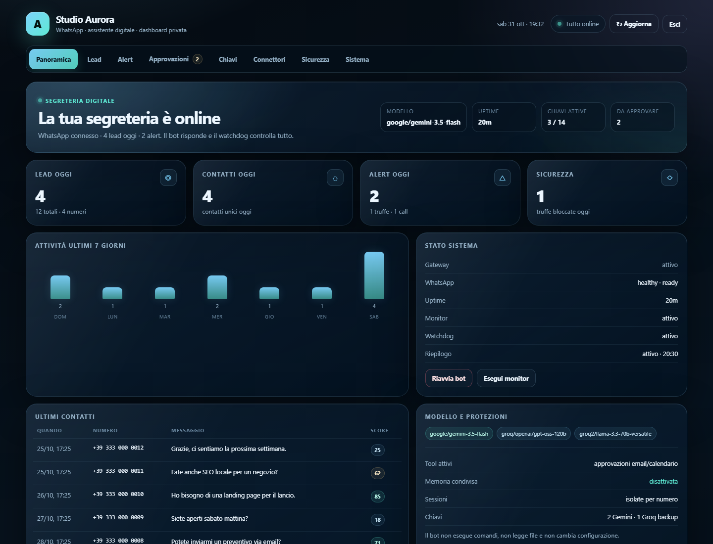

# Segreteria Digitale per WhatsApp

Una segreteria digitale **self-hosted** e privata per WhatsApp. Risponde ai clienti
con il tono della tua attività, conosce servizi e prezzi, raccoglie lead e richieste
di appuntamento, e prepara le azioni Gmail/Calendar che **approvi tu** dalla dashboard
locale.

> [English](README.md) · **Italiano**



## Perché questo progetto

La maggior parte dei bot WhatsApp è generica oppure è un servizio SaaS costoso. Questo
progetto gira sul tuo computer, usa i tuoi dati reali, mantiene la memoria separata per
ogni cliente e non invia mai un'email né crea un evento in calendario senza la tua
approvazione esplicita.

È costruito sopra [OpenClaw](https://openclaw.ai) e sul client non ufficiale WhatsApp
Web. Non è un prodotto WhatsApp Business API e non è affiliato a Meta o WhatsApp.

## Funzionalità

- **Primo contatto umano** — saluta il cliente con il nome del contatto WhatsApp, si
  presenta e chiede di cosa ha bisogno prima di parlare di prezzi.
- **Conoscenza dell'attività** — servizi, prezzi, orari, città, portfolio, FAQ e tono
  vivono in un unico file di configurazione, non nel codice del prompt.
- **Qualificazione lead** — riconosce richieste di preventivo, call, supporto e messaggi
  sospetti; assegna un punteggio; scrive un registro locale.
- **Richieste di appuntamento** — raccoglie data, ora e partecipanti, poi mette la
  richiesta Calendar in coda per l'approvazione.
- **Follow-up email** — scrive il testo, applica lato server un template HTML responsive
  e mette l'email in coda per l'approvazione.
- **Multilingua** — risponde in italiano o inglese in base al messaggio del cliente.
- **Conversazioni multiple** — una sessione isolata per numero, con coda per i picchi.
  Configura `maxConcurrent` in base a macchina e quota del provider.
- **Anti-truffa e anti-jailbreak** — non chiede mai OTP, password, documenti o pagamenti;
  ignora role-play ed estrazione del prompt; non rivela chiavi, istruzioni, file interni
  o dati di altri clienti.
- **Riconoscimento admin** — solo il numero verificato del titolare riceve riepiloghi
  operativi; un cliente non può diventare admin dichiarandosi tale.
- **Guardia errori tecnici** — un plugin locale sostituisce errori del provider, rate
  limit e nomi dei modelli con un breve messaggio umano.
- **Dashboard privata** — solo localhost, login con token, cookie HttpOnly, CSRF,
  rate limiting, header di sicurezza, audit log, gestione pool di chiavi, coda di
  approvazione e anteprima email.
- **Operatività** — servizi systemd utente, watchdog, riepilogo giornaliero, dashboard
  Docker opzionale e procedura di primo avvio guidata.

## Architettura

```text
WhatsApp (client Web non ufficiale)
        │
        ▼
Gateway OpenClaw (Node.js, servizio systemd utente)
        ├── sessione + contesto per ogni cliente
        ├── pool modelli: prima Gemini, fallback Groq
        ├── plugin secretary-guard (nasconde gli errori tecnici)
        └── tool MCP di approvazione (richiesta email / calendario)
                 │
                 ▼
Dashboard locale (Python, 127.0.0.1:8787)
        ├── approvazioni → Gmail / Google Calendar
        ├── lead, alert, audit, pool chiavi
        └── timer watchdog, monitor, digest
```

La dashboard e la coda di approvazione girano sulla stessa macchina del gateway.
Nessun dato dei clienti viene inviato a un servizio dashboard di terze parti.

## Requisiti

- Linux o WSL2 con systemd utente
- Python **3.11+** (solo standard library)
- Node.js **22+** e [OpenClaw](https://openclaw.ai) installato globalmente
- Un account WhatsApp per il bot (consigliato un numero dedicato)
- Almeno una chiave AI (i tier gratuiti Gemini e/o Groq funzionano)
- Opzionale: CLI `gog` + account Google per Gmail/Calendar, oppure il bridge Google
  Apps Script incluso

> L'automazione di WhatsApp Web può portare al ban del numero. Usa un numero dedicato,
> rispetta i termini di WhatsApp e leggi le [note di sicurezza](SECURITY.md).

## Avvio rapido

```bash
git clone https://github.com/tuo-nome/whatsapp-digital-secretary.git
cd whatsapp-digital-secretary

# 1. Crea la configurazione dell'attività e la persona del bot
python3 setup.py

# 2. Inserisci le chiavi AI nel file privato
install -m 600 secrets.env.example ~/.openclaw/secretary/secrets.env
${EDITOR:-nano} ~/.openclaw/secretary/secrets.env

# 3. Installa dashboard, timer, plugin e drop-in del gateway
bash scripts/install.sh

# 4. Apri la dashboard e copia il token locale quando richiesto
#    http://127.0.0.1:8787
#    token: ~/.openclaw/secretary/dashboard_token
```

L'installer esegue `sync_fallbacks.py`, che sceglie Gemini come modello principale se
esiste una chiave Gemini e mantiene Groq come fallback. Riavvia il gateway; WhatsApp può
impiegare un minuto a riconnettersi.

### Connessione WhatsApp

OpenClaw gestisce la sessione WhatsApp. Al primo avvio apri la control UI di OpenClaw
oppure esegui il comando di login del canale e scansiona il QR con il telefono del bot.
I file di sessione stanno in `~/.openclaw` e non vanno mai committati.

## Configurazione

Tutti i dati dell'attività vivono in `~/.config/digital-secretary/config.json`. Parti da
[`config.example.json`](config.example.json) oppure lascia che `setup.py` lo crei.

| Campo | Significato |
| --- | --- |
| `business_name` | Nome mostrato ai clienti e nella dashboard |
| `owner_name` | Nome del titolare usato dal bot |
| `bot_name` | Nome dell'assistente |
| `owner_number` | Numero admin verificato in formato E.164 |
| `google_account` | Account Gmail per i follow-up |
| `language` | Lingua predefinita (`italiano`, `English`, …) |
| `timezone` | Fuso IANA, es. `Europe/Rome` |
| `site_url` | Portfolio o sito web |
| `city` | Zona di servizio |
| `services` | Elenco dei servizi |
| `hours` | Orari di apertura / testo fuori orario |
| `pricing_note` | Formula prezzi approvata; non inventare prezzi |
| `dashboard_port` | Porta locale della dashboard (default `8787`) |
| `max_concurrent` | Chiamate AI in parallelo (default `3`) |
| `max_reply_lines` | Lunghezza massima della risposta WhatsApp |
| `whatsapp_number` | Numero del bot, solo per visualizzazione |

Variabili d'ambiente come `BUSINESS_NAME`, `OWNER_NUMBER` e `DASHBOARD_PORT` hanno
precedenza sul file JSON.

### Persona

`persona_template.md` contiene le regole di comportamento. `setup.py` le rende con i
dati dell'attività in `~/.openclaw/workspace/AGENTS.md`. Modifica il template (non il
file generato) e rilancia `python3 setup.py` per applicare le modifiche.

### Pool di provider AI

La pagina **Chiavi** della dashboard salva le chiavi in
`~/.openclaw/secretary/secrets.env` con permessi `600` e può testarle una per una.
Gemini supporta un pool separato da virgole tramite `GEMINI_API_KEYS`; le chiavi Groq
di backup creano i provider `groq2…groq7`.

I tier gratuiti hanno limiti reali. Una singola chiave Gemini può rifiutare un picco di
cinque conversazioni simultanee con HTTP 429. Per un uso intenso aggiungi due o tre
chiavi Gemini di progetti/account separati, oppure abbassa `max_concurrent` e lascia
che la coda assorba il picco.

### Gmail e Google Calendar

Ci sono due strade:

1. **Bridge Apps Script (consigliato, senza dominio)** — una web app privata Apps Script
   firma le richieste con HMAC-SHA256 ed espone solo `sendEmail` e `createEvent`.
   Evita la scadenza del refresh token dopo ~7 giorni tipica di un'app OAuth in Testing.
   Vedi [`google-bridge/README.md`](google-bridge/README.md).
2. **CLI locale `gog`** — flusso OAuth desktop. La dashboard invoca `gog` solo dopo
   l'approvazione. Le app in Testing possono richiedere una nuova autorizzazione dopo
   circa sette giorni.

Il bot non ha un tool diretto per Gmail/Calendar. Può solo creare una richiesta di
approvazione; la dashboard esegue l'azione approvata.

## Sicurezza

- La dashboard ascolta solo su `127.0.0.1` e richiede un token locale.
- Il confronto del token è constant-time; il cookie è `HttpOnly` + `SameSite=Strict`.
- Le POST richiedono `X-Requested-With: dashboard` e un `Origin` same-origin.
- Header di sicurezza: CSP, `X-Frame-Options: DENY`, `nosniff`, referrer policy.
- Rate limiting sul login e rotazione del token dalla scheda Sicurezza.
- I segreti stanno in file `600` fuori dal repository.
- Profilo tool `minimal`; code mode disattivato; al modello sono esposti solo i due
  tool MCP di approvazione.
- Il plugin guard ripulisce gli errori tecnici prima che arrivino su WhatsApp.
- I log oscurano numeri di telefono e contenuto dei messaggi per default.

Vedi [SECURITY.md](SECURITY.md) per il modello di minaccia e come segnalare una
vulnerabilità.

## Test

```bash
python3 -m unittest discover -s tests -v
python3 -m py_compile *.py google-bridge/*.py
node google-bridge/test_code_gs.js
python3 monitor.py --self-test
python3 watchdog.py --self-test
```

La suite copre configurazione, rendering della persona, archivio approvazioni, sicurezza
del template email, autenticazione/CSRF della dashboard, stato del watchdog e selezione
automatica dei modelli. L'integrazione con un numero WhatsApp reale e un account Google
reale non è testabile in CI; vedi [docs/TESTING.md](docs/TESTING.md) per la checklist
manuale.

## Docker (solo dashboard)

La dashboard può girare in un container mentre OpenClaw e WhatsApp restano sull'host:

```bash
cp .env.example .env
# modifica .env
docker compose up -d --build
```

Il compose monta `~/.openclaw` e `~/.config/digital-secretary`, pubblica la porta solo
sul loopback dell'host e raggiunge il gateway tramite il localhost forwarding di
Linux/WSL2. Dentro il container la dashboard ascolta su `0.0.0.0`, ma non è mai
esposta oltre `127.0.0.1` sull'host. L'immagine presuppone UID/GID 1000 (il primo
utente Linux/WSL2). Non è un container WhatsApp completo: il client non ufficiale e la
sua sessione restano intenzionalmente sull'host, e i widget basati su systemd (uptime
gateway, timer) non sono disponibili nel container.

## Deploy su VPS

1. Installa Node.js, OpenClaw e Python 3.11+.
2. Completa l'onboarding OpenClaw e il login WhatsApp.
3. Esegui `python3 setup.py` e `bash scripts/install.sh`.
4. Lascia la dashboard su localhost e accedila con un tunnel SSH:
   `ssh -L 8787:127.0.0.1:8787 utente@vps`.
5. Abilita il lingering (`sudo loginctl enable-linger $USER`) perché i servizi
   sopravvivano al logout.
6. Fai backup cifrati di `~/.openclaw` e `~/.config/digital-secretary`: contengono la
   sessione WhatsApp e le chiavi private.

Non esporre la porta 8787 su Internet.

## Risoluzione problemi

| Sintomo | Controllo |
| --- | --- |
| La dashboard dice `auth` | Copia il token da `~/.openclaw/secretary/dashboard_token` |
| WhatsApp si riconnette spesso | Controlla i log del gateway; un 408 è normale durante la riconnessione, riavvia solo dopo errori ripetuti |
| `413` / context overflow | Usa un modello con contesto più ampio o riduci la persona; Gemini è preferito per prompt lunghi |
| Quota `429` | Aggiungi una chiave Gemini/Groq o abbassa `maxConcurrent`; i tier gratuiti sono limitati |
| Gmail non funziona | Ri-autorizza `gog` o attiva il bridge Apps Script; controlla la scheda Connettori |
| Dashboard lenta | Lo stato WhatsApp arriva dallo snapshot del watchdog; esegui `watchdog.py` e controlla `watchdog_state.json` |
| Avvio gateway lento | Store di sessioni grandi e manutenzione al primo avvio possono richiedere minuti; lascia il servizio attivo ed evita riavvii a raffica |

## Roadmap

- Adattatore ufficiale WhatsApp Business Cloud API
- Canali Telegram ed email
- Calendario interno con regole di disponibilità
- Export CSV e webhook CRM
- Trascrizione messaggi vocali con modello locale
- Helm chart e immagine container hardened

## Contribuire

Issue e pull request sono benvenute. Leggi [CONTRIBUTING.md](CONTRIBUTING.md) e
[CODE_OF_CONDUCT.md](CODE_OF_CONDUCT.md). Non includere mai dati reali di clienti,
token o numeri di telefono in una issue.

## Licenza

MIT — vedi [LICENSE](LICENSE).

## Avvertenza

Questo progetto usa l'automazione non ufficiale di WhatsApp Web. Non è approvato da
WhatsApp, Meta, Google, Groq o OpenClaw e non è affiliato a queste società. Sei
responsabile del rispetto dei Termini di servizio di WhatsApp, delle policy API di
Google e della normativa privacy applicabile (GDPR incluso). Uso a proprio rischio.
