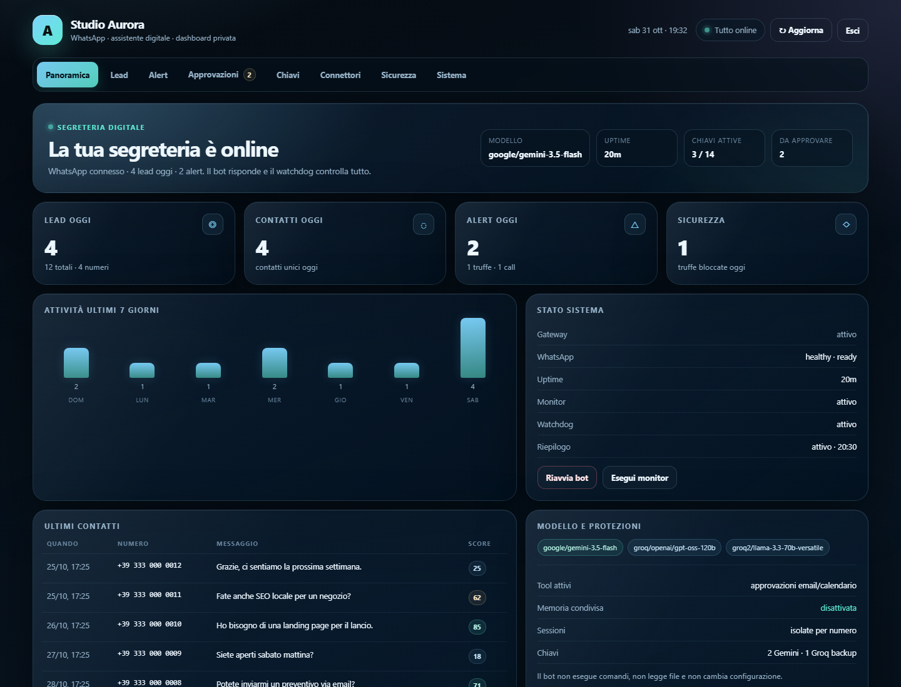
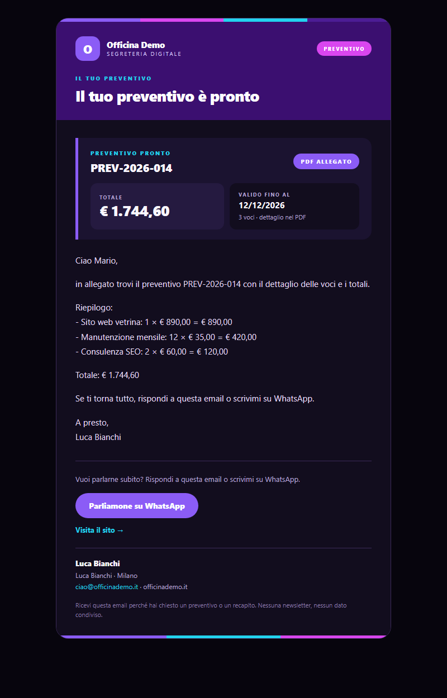
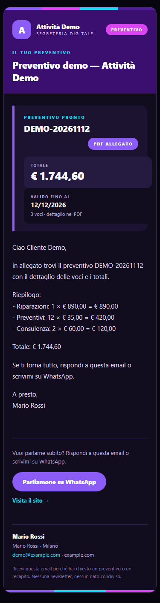

# WhatsApp Digital Secretary

> **Official source repository** for the self-hosted WhatsApp Digital Secretary.
> This is an independent project: it is not a WhatsApp/Meta product and is not
> affiliated with WhatsApp or Meta.

[](https://github.com/AhsenKurtoski/whatsapp-digital-secretary/actions/workflows/ci.yml)
[](https://github.com/AhsenKurtoski/whatsapp-digital-secretary/releases)
[](LICENSE)
[](https://github.com/AhsenKurtoski/whatsapp-digital-secretary/actions/workflows/ci.yml)

A self-hosted, private digital secretary for WhatsApp. It answers customers in your
business tone, knows your services and prices, collects leads and appointment
requests, and prepares Gmail/Calendar actions that **you approve** from a local
dashboard.

> **English** · [Italiano](README.it.md)



<details>
<summary>Email di preventivo — anteprima</summary>




</details>

## Project status

| | |
|---|---|
| **Latest release** | [v1.1.1](https://github.com/AhsenKurtoski/whatsapp-digital-secretary/releases/tag/v1.1.1) — reliable Google bridge, accurate health with an active bridge |
| **CI on `main`** | [All checks passing](https://github.com/AhsenKurtoski/whatsapp-digital-secretary/actions/workflows/ci.yml) (last verified 12 Nov 2026): unit tests, every Python self-test, email delivery tests, Apps Script bridge handlers, shell syntax |
| **Python** | 3.11, 3.12, 3.13 and 3.14, all covered by CI |
| **Platform** | Linux or WSL2 with systemd user services; optional Docker dashboard |
| **License** | MIT |

## Why this project

Most WhatsApp bots are either generic chatbots or expensive SaaS products. This
project is different: it runs on your computer, uses your real business data, keeps
conversation memory per customer, and never sends an email or creates a calendar
event without an explicit approval.

It is built on top of [OpenClaw](https://openclaw.ai) and the WhatsApp Web client.
It is independent software, not a WhatsApp Business API product and not affiliated
with Meta or WhatsApp.

## Features

- **Human-like first contact** — greets the customer by the WhatsApp contact name,
  introduces itself, and asks what they need before quoting a price.
- **Business knowledge** — services, prices, hours, city, portfolio, FAQs and tone
  live in one configuration file, not in the prompt source code.
- **Lead qualification** — detects quotes, calls, support requests and suspicious
  messages; scores leads; writes an audit trail.
- **Appointment requests** — collects date/time and attendees, then queues a
  Calendar request for approval.
- **Email follow-ups** — writes a plain-text email and applies a fully coloured,
  responsive HTML template server-side (violet/cyan on deep indigo, quote summary,
  buttons and footer). Preview it in the dashboard before approving; there are no
  remote images, web fonts or tracking pixels.
- **Manual quotes from the dashboard** — *Nuovo preventivo* lets the owner create a
  branded PDF without the bot, the AI provider or WhatsApp: items, discount, VAT,
  validity and notes, totals recalculated server-side, then the usual approval step.
  Duplicate an old quote in one click when a customer asks for an updated version.
- **Quote lifecycle** — expiry date with a “scaduto” badge, search, per-quote email
  preview, resend by duplication, and a CSV export for Excel or your accountant.
- **PDF quotes** — builds a branded A4 quote (items, quantity, unit price, discount,
  VAT and totals recalculated server-side), keeps it downloadable from the dashboard,
  and attaches it to the approval email. The email also shows a summary card with
  number, total and validity, and **Preventivo di prova** sends a complete demo with a
  real PDF so you can check Gmail colours and delivery in one click.
- **Local demo preview** — *Anteprima demo* in the Preventivi tab renders the full email
  and the generated PDF in the dashboard without queueing a request or sending anything.
  The same template stacks cleanly at 375 px, so colours and mobile layout can be
  checked before the real test email.
- **Real contact history** — reads the local OpenClaw transcripts in read-only mode,
  merges them with classified leads and open requests, and sends the owner a compact
  WhatsApp summary of who wrote, what they asked and what is still pending.
- **Owner reminders** — an hourly, deduplicated WhatsApp reminder for approvals waiting
  too long, upcoming appointments and expiring tokens.
- **Multilingual** — answers in Italian or English based on the customer's message.
- **Multiple conversations** — one isolated session per phone number, with a queue
  for bursts. Configure `maxConcurrent` for your machine and provider quota.
- **Anti-fraud and anti-jailbreak** — never asks for OTPs, passwords, documents or
  payments; ignores role-play and prompt-extraction attempts; never reveals keys,
  prompts, internal files or other customers' data.
- **Business-only scope** — questions about the owner's private life, his social
  profiles, other people or unrelated tasks get one neutral line ("non sono abilitato
  a rispondere su questo") and the conversation returns to the business.
- **Burst-safe** — WhatsApp debounce and `collect` queueing coalesce rapid messages,
  then the guard plugin drops identical inbound copies while the first is pending
  (up to 120 seconds, covering a slow gateway queue) and for 15 seconds after it has
  been answered, **before the model is called**, and cancels an identical reply within
  45 seconds. The first copy is still answered: six "1" messages cost one answer and no
  extra tokens. If the first turn fails, the pending key is released so a retry is not
  dropped as a duplicate.
  `before_dispatch` has no extra permission requirement; the retry uses `agent_end`,
  which requires `plugins.entries.secretary-guard.hooks.allowConversationAccess=true`
  (set by `scripts/install.sh`).
- **Admin recognition** — only the owner's verified number gets operational
  summaries; a customer cannot become admin by claiming to be the owner.
- **Technical-error guard** — a local plugin replaces provider errors, rate limits
  and model names with a short human holding message.
- **Private dashboard** — localhost only, token login, HttpOnly cookie, CSRF
  protection, rate limiting, security headers, audit log, key pool management,
  approval queue, and email preview.
- **Operations** — systemd user services, watchdog, daily digest, optional Docker
  dashboard, and a setup wizard.
- **Tool capability check** — the dashboard verifies that the bot actually sees the
  three approval tools and shows the owner a banner if it does not, instead of letting
  a customer hear “I don't have that tool”. `doctor.py` runs the installed MCP server
  (`tools/list` + a real PDF) with the `mcp_runtime` check.
- **Self-diagnosis** — `doctor.py` checks the installed files, the Preventivi/Contatti
  tabs, the PDF engine, the persona scope rules, the anti-burst policy, the OpenClaw
  minimum version and compatibility features, the MCP tool allowlist, systemd units and
  the local APIs, then prints the exact command that fixes each problem. The same report is one click away in the dashboard (Sistema → Diagnosi)
  and runs at the end of `scripts/install.sh`. `--fix` applies the safe repairs it finds
  (MCP allowlist, anti-burst policy, plugin retry permission, inactive services) after a confirmation for every
  change; `--yes` skips the questions for scripted runs.
- **Health and token alerts** — a 30-minute scan checks configuration, secrets,
  gateway, WhatsApp, dashboard, timers, Google OAuth/bridge, MCP, AI keys, approvals,
  disk and Windows autostart. It sends a deduplicated WhatsApp alert to the owner when
  a token expires or a service breaks, and shows the full report in the dashboard.

## Architecture

```text
WhatsApp (Web client)
        │
        ▼
OpenClaw gateway (Node.js, systemd user service)
        ├── per-customer session + context
        ├── model pool: Gemini first, Groq fallback
        ├── secretary-guard plugin (burst dedupe + technical-error scrubber)
        └── approval MCP tools (request email / calendar / PDF quote)
                 │
                 ▼
Local dashboard (Python, 127.0.0.1:8787)
        ├── approvals → Gmail / Google Calendar
        ├── leads, alerts, audit, key pool
        └── watchdog, monitor, digest timers
```

The dashboard and the approval queue run on the same machine as the gateway. No
customer data is sent to a third-party dashboard service.

## Requirements

- Linux or WSL2 with systemd user services
- Python **3.11+**, tested in CI on 3.11, 3.12, 3.13 and 3.14 (standard library only; on
  native Windows install `tzdata` for the full IANA timezone database)
- Node.js **22+** and [OpenClaw](https://openclaw.ai) **2026.4.22+** installed globally
  (the inbound burst guard uses `before_dispatch`; the installer rejects versions below
  **2026.4.22**, detects the optional `--accept-capabilities` and
  `allowConversationAccess` features, and warns instead of silently disabling the
  retry on hosts that lack them)
- A WhatsApp account for the bot (a separate number is recommended)
- At least one AI provider key (Gemini and/or Groq free tiers work)
- Optional: `gog` CLI + Google account for Gmail/Calendar, or the included
  Google Apps Script bridge

> WhatsApp Web automation can lead to a number ban. Use a dedicated number, respect
> WhatsApp's terms, and read the [security notes](SECURITY.md).

## Try it in 60 seconds

No API keys, no WhatsApp, no Google account:

```bash
git clone https://github.com/AhsenKurtoski/whatsapp-digital-secretary.git
cd whatsapp-digital-secretary
python3 demo.py
```

A local dashboard opens on `http://127.0.0.1:8799` with demo leads, a generated PDF
quote and a pending email. The token is printed in the terminal. Nothing is sent and
your real installation is not touched.

## Quick start

```bash
git clone https://github.com/AhsenKurtoski/whatsapp-digital-secretary.git
cd whatsapp-digital-secretary

# 1. Create the business configuration and the persona
python3 setup.py

# 2. Put your AI keys in the private environment file
install -m 600 secrets.env.example ~/.openclaw/secretary/secrets.env
${EDITOR:-nano} ~/.openclaw/secretary/secrets.env

# 3. Install dashboard, timers, plugin, remote-access helper and gateway drop-ins
bash scripts/install.sh

# 4. Open the dashboard and copy the local token when asked
#    http://127.0.0.1:8787
#    token: ~/.openclaw/secretary/dashboard_token
```

The installer runs `sync_fallbacks.py`, which selects Gemini as the main model when
a Gemini key exists and keeps Groq as fallback. It restarts the gateway; WhatsApp may
take a minute to reconnect.

> Using an AI coding agent? [`AGENTS.md`](AGENTS.md) is the exact install and
> verification checklist, including the Google and WhatsApp checks.

### WhatsApp connection

OpenClaw manages the WhatsApp session. On first run, open the OpenClaw control UI or
run its channel login command and scan the QR code with the bot's phone. Session files
are stored under `~/.openclaw` and must never be committed.

### Gmail and Calendar

Approvals can use the `gog` CLI or the included **Apps Script bridge**. The bridge is
recommended because it does not expire after the 7-day Testing limit of a Google OAuth
app. Run it once and approve Gmail + Calendar in the browser:

```bash
bash ~/.openclaw/secretary/google-bridge/installa-bridge.sh
```

Then open **Connettori → Verifica bridge** in the dashboard. The health check verifies
that the bridge is reachable and that the signed `health` call can access both Gmail
and Calendar. With `gog`, the equivalent command is:

```bash
gog-secretary auth add your-account@gmail.com \
  --services gmail,calendar --gmail-scope read-send --manual
```

Both paths keep email and event actions behind dashboard approval. A configured file
is not proof of delivery: use **Preventivo di prova** and one real Calendar approval to
confirm the account, then check the message and the event.

## Configuration

All business data lives in `~/.config/digital-secretary/config.json`. Start from
[`config.example.json`](config.example.json), or let `setup.py` create it.

| Field | Meaning |
| --- | --- |
| `business_name` | Name shown to customers and in the dashboard |
| `owner_name` | Owner's name used by the bot |
| `bot_name` | Assistant name |
| `owner_number` | Verified admin number in E.164 format |
| `google_account` | Gmail account used for follow-ups |
| `language` | Default language (`italiano`, `English`, …) |
| `timezone` | IANA timezone, e.g. `Europe/Rome` |
| `site_url` | Portfolio or website |
| `city` | Service area |
| `services` | List of services |
| `hours` | Opening hours / out-of-office text |
| `pricing_note` | Approved price wording; never invent prices |
| `dashboard_port` | Local dashboard port (default `8787`) |
| `max_concurrent` | AI calls processed in parallel (default `3`) |
| `max_reply_lines` | Maximum WhatsApp reply length |
| `whatsapp_number` | Bot number, for display only |
| `quote_prefix` | Prefix for quote numbers (default `PREV`) |
| `vat_rate` | Default VAT percentage, e.g. `22` |
| `quote_valid_days` | Quote validity in days (default `30`) |
| `payment_terms` | Payment terms printed on every quote |
| `reminder_min_age_minutes` | How long an approval may wait before a reminder |
| `reminder_cooldown_hours` | Minimum gap between two reminders for the same item |

Environment variables such as `BUSINESS_NAME`, `OWNER_NUMBER` and
`DASHBOARD_PORT` override the JSON file.

### Persona

`persona_template.md` contains the behavioural rules. `setup.py` renders it with your
business data into `~/.openclaw/workspace/AGENTS.md`. Edit the template (not the
generated file) and re-run `python3 setup.py` to apply changes.

### AI provider pool

The dashboard **Keys** page stores keys in `~/.openclaw/secretary/secrets.env` with
mode `600` and can test each key. Gemini supports a comma-separated pool through
`GEMINI_API_KEYS`; Groq backup keys create `groq2…groq7` providers.

Free tiers have real limits. A single Gemini key may reject a burst of five
simultaneous conversations with HTTP 429. For heavy parallel use, add two or three
Gemini keys from separate projects/accounts, or lower `max_concurrent` and let the
queue absorb the burst.

### Gmail and Google Calendar

There are two options:

1. **Apps Script bridge (recommended, no domain)** — a private Apps Script web app
   signs requests with HMAC-SHA256 and exposes only `sendEmail` and `createEvent`.
   It avoids the 7-day refresh-token expiry of an OAuth app in Testing mode. See
   [`google-bridge/README.md`](google-bridge/README.md).
2. **Local `gog` CLI** — OAuth desktop flow. The dashboard invokes `gog` only after
   approval. Testing-mode apps may require re-authorization after about seven days.

When the token is expired or about to expire, the dashboard shows a warning above every
tab. **Riautorizza Google** generates the real consent URL; after “Consenti” you paste
the final `…/oauth2/callback?code=…` address into Health and the dashboard exchanges the
code and verifies Gmail. Only loopback redirects are accepted and the code is never
logged.

The bot itself has no direct Gmail/Calendar tool. It can only create an approval
request; the dashboard executes the approved action. For quotes, the PDF is generated
locally when the request is created and is attached only after approval.

## Security

- Dashboard binds to `127.0.0.1` only and requires a local token.
- Token comparison is constant-time; the cookie is `HttpOnly` + `SameSite=Strict`.
- POST requests require `X-Requested-With: dashboard` and a same-origin `Origin`.
- Security headers: CSP, `X-Frame-Options: DENY`, `nosniff`, referrer policy.
- Login rate limiting and token rotation from the Security tab.
- Secrets are stored in `600` files outside the repository.
- Tool profile is `minimal`; code mode is disabled; only the three approval MCP tools
  (email, calendar, quote) are exposed to the model.
- The guard plugin scrubs technical errors before they reach WhatsApp.
- Logs redact phone numbers and message content by default.

See [SECURITY.md](SECURITY.md) for the threat model and how to report a vulnerability.

## Tests

One command runs the whole matrix (compile, unit tests, every self-test, the Apps
Script bridge, the guard plugin and a real PDF generation):

```bash
bash scripts/verify.sh
```

The individual commands:

```bash
python3 -m unittest discover -s tests -v
python3 -m unittest discover -s tests -p 'test_install.py' -v
python3 -m unittest discover -s tests -p 'test_remote_access.py' -v
python3 -m py_compile *.py google-bridge/*.py scripts/*.py
python3 scripts/openclaw_compat.py --json
bash scripts/install.sh --check-compat
python3 scripts/smoke_guard.py
node google-bridge/test_code_gs.js
node plugins/secretary-guard/test_guard.js
python3 google-bridge/test_bridge.py
python3 monitor.py --self-test
python3 watchdog.py --self-test
python3 healthcheck.py --self-test
python3 contacts.py --self-test
python3 reminders.py --self-test
python3 gateway_policy.py --self-test
python3 doctor.py --self-test
python3 remote_access.py --self-test
python3 doctor.py --offline
```

The suite covers configuration, persona rendering and jailbreak/refusal guards,
approval storage, email template safety, dashboard authentication/CSRF, watchdog
status, health scoring/token alerts, automatic model selection, isolated installer
copies, OpenClaw compatibility planning, private remote-access validation and
inbound/outbound duplicate suppression. Integration with a real WhatsApp number and a real Google account cannot
be tested in CI; see [docs/TESTING.md](docs/TESTING.md) for the manual checklist.

## Docker (dashboard only)

The dashboard can run in a container while OpenClaw and WhatsApp run on the host:

```bash
cp .env.example .env
# edit .env
docker compose up -d --build
```

The compose file mounts `~/.openclaw` and `~/.config/digital-secretary`, publishes the
port on host loopback only, and reaches the gateway through the WSL2/Linux localhost
forwarding. Inside the container the dashboard listens on `0.0.0.0`, but it is never
exposed beyond `127.0.0.1` on the host. The image expects host UID/GID 1000 (the
default first Linux/WSL2 user). This is not a full WhatsApp container: the
WhatsApp Web client and its session are intentionally kept on the host, and systemd-only
widgets (gateway uptime, timers) are unavailable inside the container. Key management
and the restart button in the container do not control the host gateway: edit
`~/.openclaw/secretary/secrets.env` on the host or use the host dashboard.

## Gina platform (v1.3): intelligence, roles, GDPR, backups

Everything below is implemented and tested, not a roadmap:

| Area | What it does | Command / document |
|---|---|---|
| Intent and audit | intent, IT/EN language, score, scam signals, audit trail without full text | `python3 lead_intel.py --json --text "..."` |
| Per-customer memory | language, facts, intents, redacted transcript, handoff | `python3 memory.py --profile +39...` |
| Latency | TTL cache for frequent answers with hit rate | `python3 cache.py --stats` |
| Dynamic model | chooses by load, latency and 429s; explicit apply | `python3 router.py --load 4` |
| Live replies | intent, per-customer memory and verified cache behind the `client_brief` tool; the guard plugin feeds every real message | `python3 live.py --brief "A che ora aprite?" --json` |
| AI quotas | requests, tokens, 429s, thresholds and alerts | `python3 quotas.py --json` |
| Users and roles | admin / operator / viewer, hashed tokens, per-user audit | `python3 identity.py --add "Anna" --role operator` |
| Webhooks | HMAC-signed events to Zapier/Make/HubSpot | `python3 webhooks.py --list` |
| Conversations | read-only transcripts, redaction, bot→human handoff | dashboard → Conversations |
| Analytics | KPIs and 14-day series from real data | dashboard → Analytics |
| GDPR | access, erasure, retention, data inventory | [`docs/GDPR.md`](docs/GDPR.md) · `python3 gdpr.py --report` |
| Encrypted backup | AES-256-GCM, rotation, restore verified with SHA-256 | [`docs/DISASTER_RECOVERY.md`](docs/DISASTER_RECOVERY.md) |
| WhatsApp ban | operational plan and customer communication | [`docs/WHATSAPP_BAN.md`](docs/WHATSAPP_BAN.md) |
| Plugins | API, hooks and a runnable example | [`docs/PLUGINS.md`](docs/PLUGINS.md) · `examples/hello-plugin` |
| Docker | full-stack compose with OpenClaw | [`docs/DOCKER.md`](docs/DOCKER.md) |
| Quality | ruff, mypy, bandit, pip-audit, 87% coverage (gate 86%) | `bash scripts/coverage.sh` |
| E2E and video | test accounts, checklist, 60 s storyboard | [`docs/E2E.md`](docs/E2E.md) · [`docs/WALKTHROUGH.md`](docs/WALKTHROUGH.md) |

Guided setup with real checks (AI key, WhatsApp gateway, test email):

```bash
python3 setup.py --wizard
```

## Running 24/7 for free

There is no free hosting that keeps a process alive without a machine that stays on.
Two options actually cost 0 € (details and limits in [`docs/ALWAYS_ON.md`](docs/ALWAYS_ON.md)):

- **Your own device** (spare mini-PC, Raspberry Pi or an always-on PC) — no card, no
  subscription; disable sleep and run `sudo loginctl enable-linger $USER` so services
  start at boot without a login.
- **Oracle Cloud Always Free** — 2 OCPU + 12 GB Arm, 200 GB disk, no end date; a card is
  required for identity verification only. Oracle may reclaim instances that stay idle,
  so check the idle rule before relying on it.

Free PaaS tiers (Render, Koyeb) sleep after 15–60 minutes and cannot keep a WhatsApp
session. Google's free e2-micro still bills the external IPv4 address. The project
already restarts the dashboard automatically (`Restart=always`), restarts the gateway
from the watchdog after two failed checks, restarts WhatsApp only after 30 minutes of
unhealthy state, and alerts the owner on WhatsApp. `doctor.py` now reports the `linger`
state, because without it services do not start after a reboot.

## Private remote access (Tailscale + SSH)

The dashboard is intentionally loopback-only. To use it from another device without
publishing it, put the host and client on a private **Tailscale** network and forward
the dashboard through **SSH**:

```bash
# on the host: install Tailscale and OpenSSH, then
tailscale up
sudo systemctl enable --now ssh

# on the client: check the prerequisites and open the private tunnel
python3 remote_access.py --check
python3 remote_access.py --host host.tailnet.ts.net --user you --connect
```

The installer copies the helper to `~/.openclaw/secretary/remote_access.py`; use that
path on an installed host (the commands above work from a checkout). Then open
`http://127.0.0.1:8787`. The dashboard never binds to a public interface; the SSH tunnel
keeps the browser origin loopback, so token login and CSRF checks work unchanged. The
Tailscale personal plan and OpenSSH are free and do not require a credit card. This is
not cloud hosting: the host must stay powered and connected. See
[`docs/REMOTE_ACCESS.md`](docs/REMOTE_ACCESS.md) for firewall, port and recovery notes.

On an Oracle Always Free VM use the dedicated installer, which also proves the dashboard
was not exposed: `bash scripts/install-oracle.sh --check` (read-only), `--prepare`, then
`--install` (see [`docs/ALWAYS_ON.md`](docs/ALWAYS_ON.md)).

For a VPS, complete onboarding and `bash scripts/install.sh`, keep port `8787` closed,
and enable user lingering (`sudo loginctl enable-linger $USER`). Back up `~/.openclaw`
and `~/.config/digital-secretary` encrypted; they contain the WhatsApp session and
private keys. Never expose port 8787 to the public Internet.

## Troubleshooting

| Symptom | Check |
| --- | --- |
| Dashboard says `auth` | Copy the token exactly from `~/.openclaw/secretary/dashboard_token` |
| WhatsApp keeps reconnecting | Check gateway logs; a 408 is normal during reconnect, restart only after repeated failures |
| `413` / context overflow | Use a model with a larger context or reduce the persona; Gemini is preferred for long prompts |
| `429` quota | Add another Gemini/Groq key or lower `maxConcurrent`; free tiers are limited |
| Gmail fails | Re-authorize `gog` or activate the Apps Script bridge; check the dashboard Connectors tab |
| Dashboard is slow | The status endpoint reads the watchdog snapshot; run `watchdog.py` once and check `watchdog_state.json` |
| Gateway startup is slow | Large session stores and first-run maintenance can take minutes; keep the service running and avoid restart loops |

## Roadmap

- WhatsApp Business Cloud API adapter
- Telegram and email channels
- Internal calendar with availability rules
- CSV export and CRM webhooks
- Voice-message transcription with a local model
- Helm chart and a hardened container image

## Contributing

Issues and pull requests are welcome. Read [CONTRIBUTING.md](CONTRIBUTING.md) and
[CODE_OF_CONDUCT.md](CODE_OF_CONDUCT.md) first. Never include real customer data,
tokens or phone numbers in an issue.

## License

MIT — see [LICENSE](LICENSE).

## Disclaimer

This project uses WhatsApp Web automation and is not endorsed by or affiliated with
WhatsApp, Meta, Google, Groq or OpenClaw. You are responsible for
complying with WhatsApp's Terms of Service, Google's API policies, and applicable
privacy law (GDPR included). Use at your own risk.
